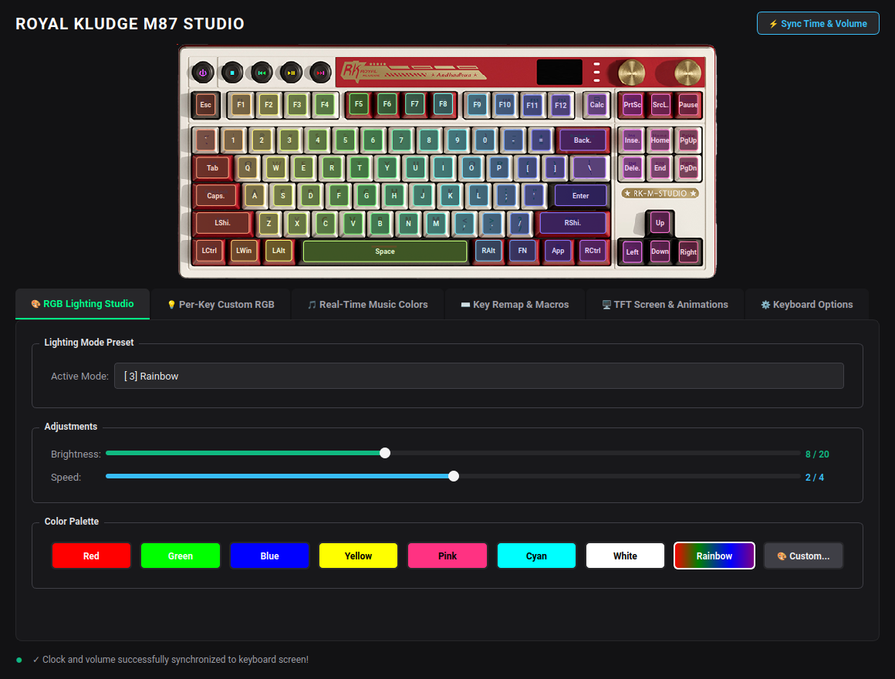
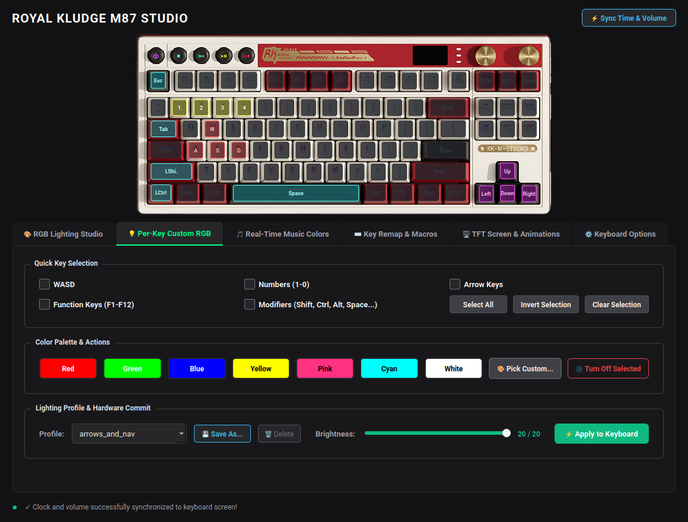
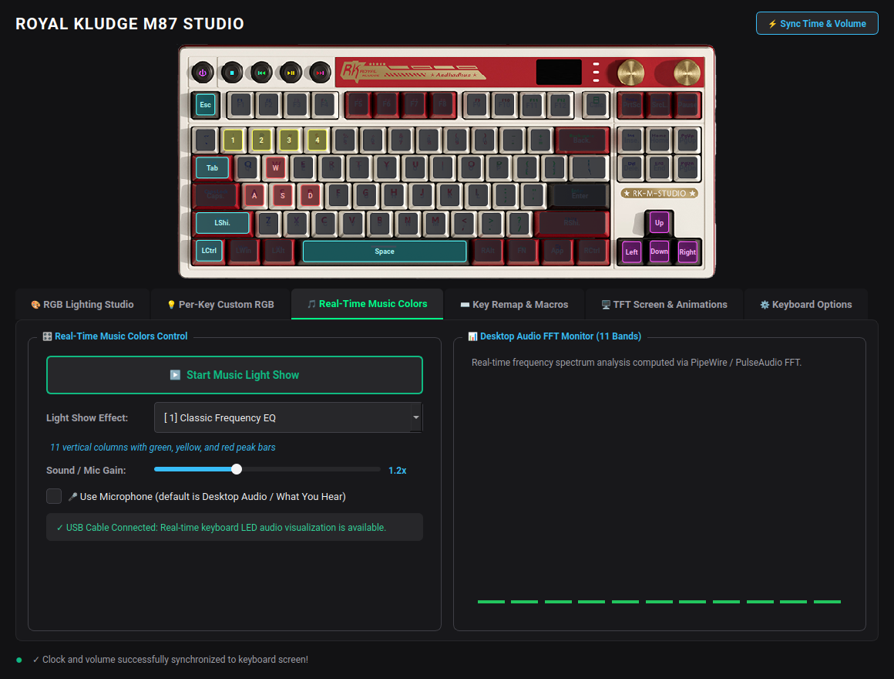
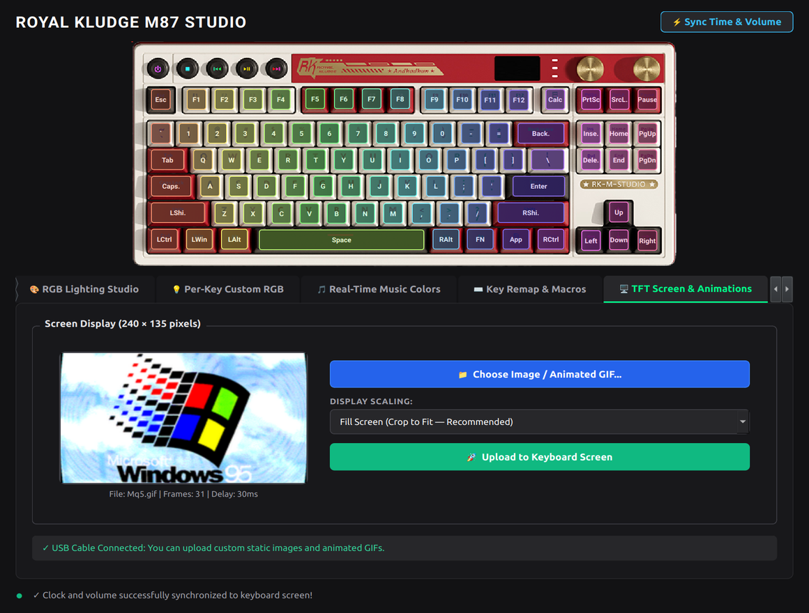
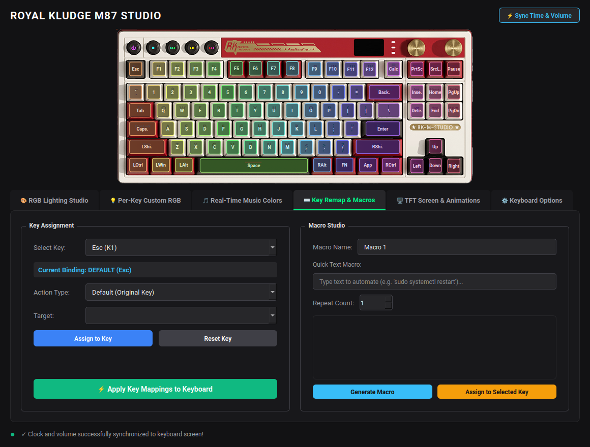
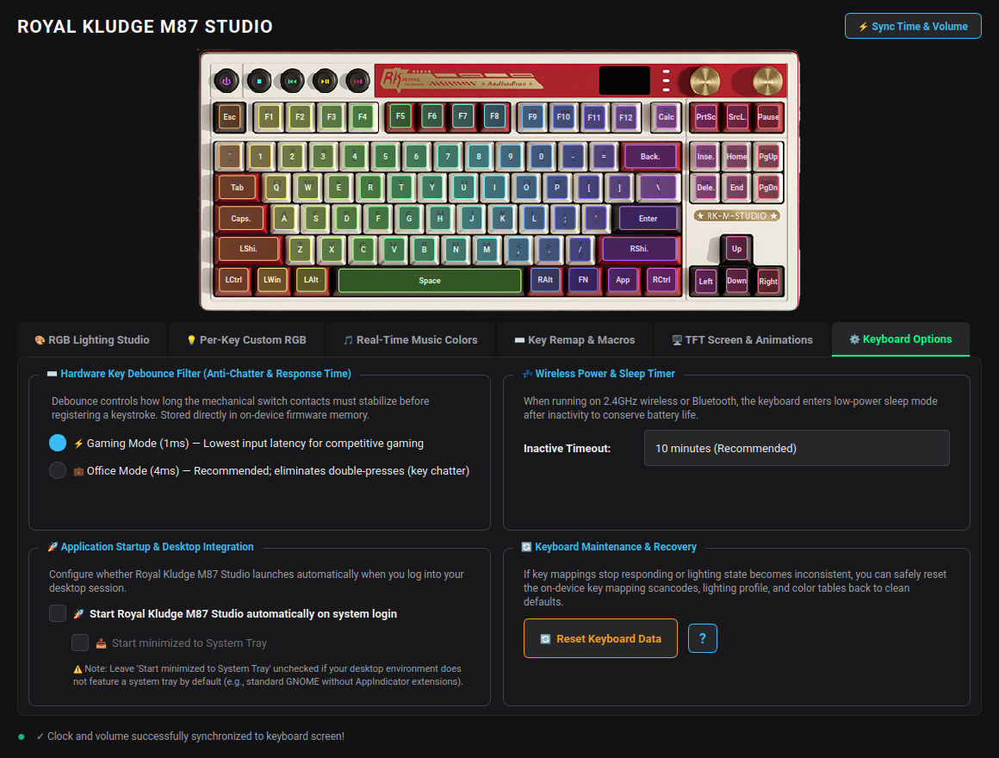

# Royal Kludge RK M87 Native Linux Driver & Studio

<div align="center">

[](https://kernel.org)
[](https://python.org)
[](https://pyside.org)
[-purple.svg?style=for-the-badge)](rkm87/protocol.py)
[](LICENSE)

**A native Linux driver and graphical desktop studio application for the Royal Kludge RK M87 mechanical keyboard with integrated color TFT LCD screen.**

*No Wine, no proprietary software, no out-of-tree kernel modules required.*

[Key Features](#-features) • [Installation](#-turnkey-installation) • [GUI Studio Showcase](#-studio-showcase) • [Hardware Protocol](#-hardware-protocol--architecture)

</div>

---

> [!WARNING]
> **Vibe-Coded Project Notice**: This project is **vibe-coded** using AI pair programming. We have tried our best to copy and replicate the functionality of the official Royal Kludge Windows software  through reverse engineering, but please note there could be bugs or edge cases.
>
> ⚠️ **Key Remapping & Macros Untested**: The **Key Remap & Macro Studio** functionality has **NOT been hardware-tested**. Use key remapping at your own discretion. If key mappings ever behave erratically:
> 1. Try restoring factory defaults via the **"Reset Keyboard Data"** button in the *Keyboard Options* tab.
> 2. If that doesn't work, unplug the keyboard from the USB cable or power it off using the physical power switch.
> 3. If issues persist, the official Royal Kludge Windows software can be installed in Wine to perform a factory reset.

---

## 📸 Studio Showcase

### 1. RGB Lighting Studio & Real-Time Canvas
Interactive 2D keyboard canvas reflecting active hardware lighting, animations, speeds, and custom palettes in real time.


### 2. Custom Per-Key RGB Designer ("Gaoshou" Matrix Mode)
Paint individual keys with exact 24-bit RGB colors. Includes built-in gaming profiles (WASD, FPS Arena, MOBA / League, Arrows & Navigation) and custom JSON profile storage with instant hardware persistence.


### 3. Real-Time Music Colors (Light Show)
Real-time 11-column audio frequency spectrum light show streaming directly to the keyboard's key matrix columns at 15 FPS. Responsive 2-column layout with logarithmic decibel scaling and peak-gravity decay.


### 4. TFT LCD Screen GIF & Image Uploader
Convert images and animated GIFs to big-endian RGB565 (240×135) with frame-by-frame dithering, 64-byte chunked streaming, and CRC safety checks directly to onboard flash storage *(Wired USB mode)*.


### 5. Key Remap & Macro Studio
Remap physical scancodes, configure multimedia and media control keys, bind mouse clicks, and design multi-step timed macro sequences across 4 hardware matrix layers.

> ⚠️ **Notice**: The key remapping and macro features have **not been tested** yet and should be considered experimental.


### 6. Hardware Options & Factory Reset
Configure ultra-low latency **Gaming Mode (1ms)** vs **Office Mode (4ms)** debounce filters, adjust wireless idle sleep timeouts, manage autostart, and safely reset the LED's/ key maps in case of stalling with a single click.


---

## ⚡ Features

- **Dual-Mode Connectivity**:
  - Automatic hotplug detection between **USB Wired Cable** (`PID 0x01A2`) and **2.4 GHz Wireless Dongle** (`PID 0x0150`).
- **Bidirectional LCD Synchronization**:
  - Automatic sync of host system RTC time to the keyboard's color LCD clock on application start.
  - Smooth synchronization of Linux master audio volume (PipeWire sink monitor / PulseAudio) with the physical volume knob and LCD volume bar.
- **Debounce Persistence**:
  - Automatically preserves and re-asserts 1ms Gaming Mode debounce across application restarts, profile changes, and LCD parameter updates.
- **Reverse-Engineered 420-Byte Flash Color Table**:
  - Full support for 21 built-in lighting effects, 7 factory preset palettes, and custom 24-bit RGB color assignments via direct flash memory manipulation.
- **Audio-Reactive Light Show**:
  - Captures Desktop Audio ("What You Hear") via PipeWire sink monitor or Microphone input.
- **System Tray Integration**:
  - Runs unobtrusively in the background with quick profile switching, lighting presets, and visualizer controls directly from the system tray.
- **Pure User-Space Architecture**:
  - Communicates directly with `/dev/hidraw` using Linux `ioctl` and standard HID feature/output reports. Non-root access is cleanly managed via udev rules.

---

## 📦 Turnkey Installation

### Prerequisites (Debian/Ubuntu/Fedora/Arch/openSUSE)
Ensure Python 3.10+ and standard tools are installed:

```bash
# Ubuntu / Debian / Pop!_OS
sudo apt update && sudo apt install -y python3 python3-pip python3-venv git

# Fedora / RHEL
sudo dnf install -y python3 python3-pip git

# Arch Linux / Manjaro
sudo pacman -S --needed python python-pip git

# openSUSE (Tumbleweed / Leap)
sudo zypper install -y python3 python3-pip python3-virtualenv git
```

### 1-Command Installation

Clone the repository and run the turnkey installer:

```bash
git clone https://github.com/vyrgozunqk/rkm87-linux.git
cd rkm87-linux
./install.sh
```

The installer will:
1. Copy udev hardware rules (`/etc/udev/rules.d/99-rk-m87.rules`) for non-root `/dev/hidraw` device access.
2. Install the application suite cleanly into `~/.RKLinux` with a self-contained Python virtual environment.
3. Install the executable launcher **`rkm87`** into `~/.local/bin/`.
4. Install the desktop launcher (`rkm87.desktop`) and icon into `~/.local/share/applications/`.

### Clean Uninstallation

To cleanly remove `~/.RKLinux`, the `rkm87` launcher, udev rules, desktop launchers, and configuration:

```bash
./install.sh --uninstall
```

*(Pass `-y` or `--yes` to skip confirmation prompts).*

---

## 🚀 Launching the GUI

Launch the studio from your application menu (search for **Royal Kludge M87 Studio**) or open a terminal:

```bash
rkm87
```

> **Quick Sync on Startup**: Whenever the GUI starts, it immediately synchronizes the current system time and volume level directly to the keyboard LCD screen.

---

## 🔬 Hardware Protocol & Architecture

### Communication Transport
The driver communicates with the SinoWealth microcontroller via Linux HID Raw interfaces:
- **Wired USB Cable (`0x01A2`)**: Uses USB Feature Reports (`_HIDIOCSFEATURE` / `_HIDIOCGFEATURE`, Report ID `0x09`, 65 bytes).
- **2.4 GHz Wireless Dongle (`0x0150`)**: Uses USB Output Reports (`0x06` endpoint, 20 bytes per chunk).

### Command Opcode Summary

| Command ID | Name | Direction | Description |
|---|---|---|---|
| `0x84` | `CMD_GET_LED` | Host ← Device | Reads 128-byte hardware profile (debounce, sleep, active effect, speed, brightness). |
| `0x04` | `CMD_SET_LED` | Host → Device | Commits 128-byte profile payload to flash memory. |
| `0x83` | `CMD_GET_LED_RGB_TAB`| Host ← Device | Reads 420-byte flash color lookup table (20 modes × 7 color slots × 3 RGB bytes). |
| `0x03` | `CMD_SET_LED_RGB_TAB`| Host → Device | Commits 420-byte color lookup table to flash memory. |
| `0x0B` | `CMD_SET_SCREEN_PARAM`| Host → Device | Synchronizes RTC year/month/day/hour/min/sec and master volume (0-100%). |
| `0x0D` / `0x0E`| `CMD_SET_GAME` | Host → Device | Real-time 126-byte matrix color streaming (Real-time music colors & Gaoshou mode). |
| `0xB7` / `0xB8`| `CMD_STREAM_SCREEN` | Host → Device | Frame chunk streaming of 240×135 RGB565 bitmap data for LCD animations. |
| `0x82` / `0x02`| `CMD_KEY_MATRIX` | Bidirectional | Reads and writes 4 matrix keymap layers (Standard, Fn1, Fn2, Fn3). |

---

## 🛡️ Compatibility

| Connection Mode | Product ID | Lighting Studio | Custom Per-Key RGB | Real-Time Music Colors | LCD GIF Upload | Debounce & Sleep | RTC / Vol Sync |
|---|---|---|---|---|---|---|---|
| **USB Cable** | `0x01A2` | ✅ | ✅ | ✅ | ✅ | ✅ | ✅ |
| **2.4 GHz Dongle** | `0x0150` | ✅ | ✅ | *(Wired Only)* | *(Wired Only)* | ✅ | ✅ |
| **Bluetooth LE** | - | Handled by the hardware |

---

## 📄 License

Distributed under the MIT License. See [LICENSE](LICENSE) for more information.

---

<div align="center">
<sub>Crafted for my own needs, but feel free to use it. It may work with other RK keyboards that share the same hardware platform, or be easily modded to work with them, however I don't have the hardware to test it</sub>
</div>
